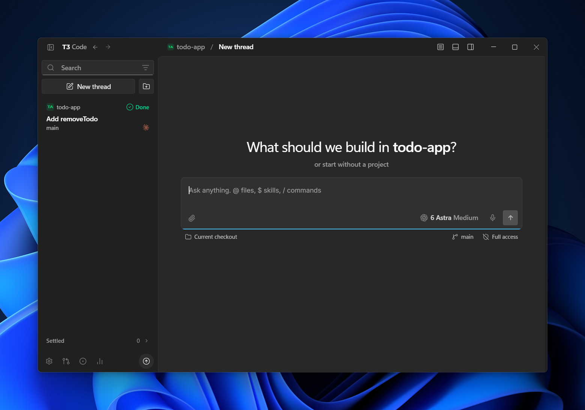
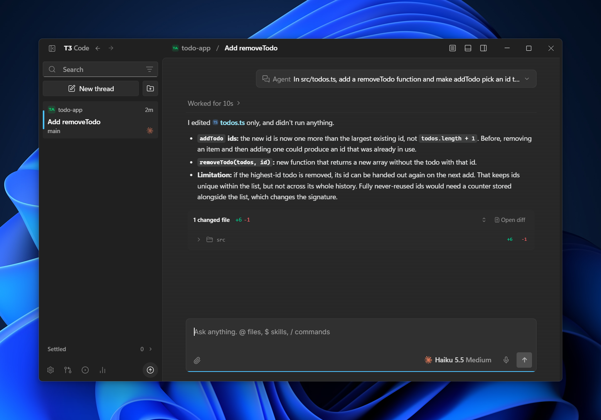
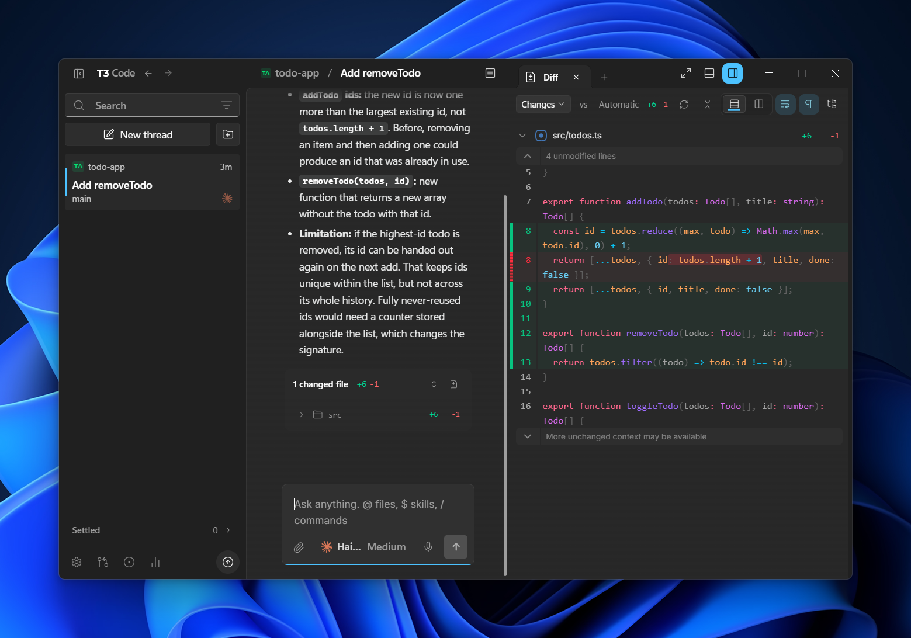
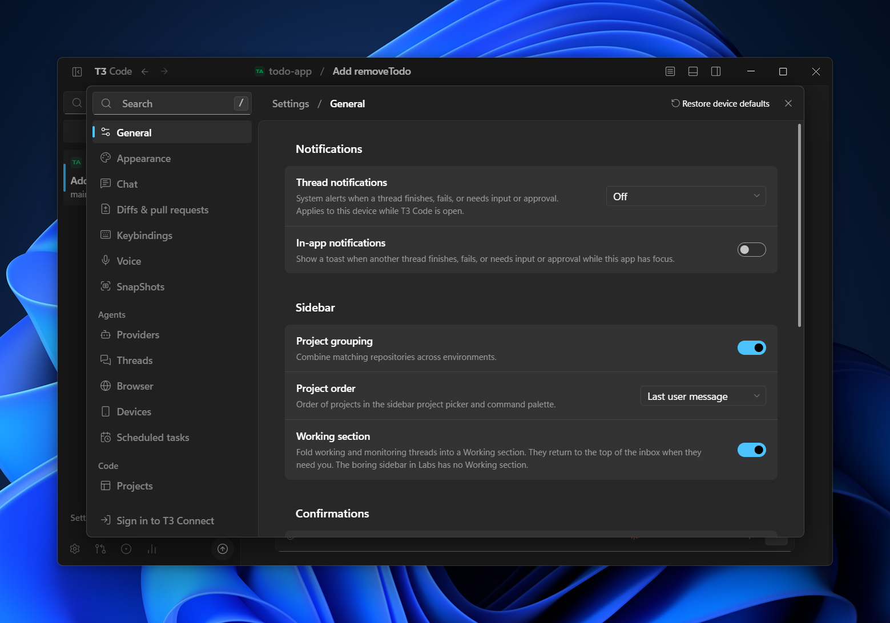

# WinUI theme for T3 Code

A Windows 11 / WinUI 3 (Fluent) theme for [T3 Code](https://github.com/pingdotgg/t3code) on web and desktop, with dark and light variants.

<p>
  <a href="screenshots/home.png"></a>
  <a href="screenshots/chat.png"></a>
  <a href="screenshots/diff.png"></a>
  <a href="screenshots/settings.png"></a>
</p>

## Install

1. Download [`winui.json`](winui.json).
2. In T3 Code, open **Settings → Appearance** and choose **Add theme**.
3. Choose the file, then **Add theme**.

Or publish it from the machine running T3 Code:

```bash
t3 theme set winui.json
```

The theme uses custom CSS, so it needs a recent version of T3 Code. Parts of it rely on T3 Code internals and may need updating after a release.

## Development

Edit the styles in [`src/theme.css`](src/theme.css) and the name and colors in [`src/theme.json`](src/theme.json), then build `winui.json`:

```powershell
./build.ps1
```

```bash
./build.sh
```

## License

[MIT](LICENSE)
